# S-band patch antenna (SSI 1U CubeSat), rev 1

Right-hand circularly polarized patch antenna for the satellite's S-band TT&C link (uplink and downlink, around 2.4 GHz). This repo holds the rev-1 KiCad boards, order-ready Gerbers, the simulations behind them and the design notes.

Research doc: PJ-10004, S-band patch antenna research (internal to SSI) · Author: Gabriel Irazabal

> **Using an AI assistant?** Point it at this repo. It should read [`CLAUDE.md`](CLAUDE.md) first.
>
> **Running the Ansys HFSS check on the Windows laptop?** Everything is in [`HFSS_TASK.md`](HFSS_TASK.md).

## Status

| Step | State |
| --- | --- |
| Requirements and design decisions | Done |
| Simulation (openEMS) | Done for five boards: two designs × two materials, plus a cut-corner PTFE board tuned for the satellite face |
| KiCad boards, size variants, Gerbers | Done: 15 boards, all DRC clean, zips in [`fab/`](fab) |
| **Decision needed: board material** | RO4350B does not reach the 6.5 dBic gain requirement; JLC's PTFE does once mounted on the satellite. See [Gain](#gain-the-one-requirement-not-met-on-ro4350b) |
| Cross-check in HFSS | Done. HFSS agrees within 0.4 % in frequency and 0.3 dB in gain. See [`sim/HFSS_RESULTS.md`](sim/HFSS_RESULTS.md) |
| JLC order, VNA test | Not done |

## Requirements and how the designs compare

Simulated on the bare 60 × 60 mm board at 2.425 GHz. Board A assumes an ideal 90° hybrid.

| Requirement | Target | A, RO4350B | B, RO4350B | A, PTFE | B, PTFE |
| --- | --- | --- | --- | --- | --- |
| Frequency | 2.4 GHz band (design centre 2.425 GHz) | ✓ | ✓ | ✓ | ✓ |
| Match across 20 MHz | return loss ≥ 10 dB | ✓ 13.5 dB | ✓ 12.2 dB | ✓ 14.3 dB | ✓ 11.6 dB |
| Gain | ≥ 6.5 dBic, ideally 7+ | ✗ 5.6–5.8 | ✗ 5.5–5.7 | ✗ 6.3–6.4 | ✗ 6.1–6.3 |
| Gain on a 100 mm metal face | same | ✗ 5.9–6.0 | ✗ 6.0–6.1 | ✓ 6.8–6.9 | ✓ 6.7–6.9 |
| Half-power beamwidth | ≥ 60° | ✓ 88° | ✓ 88° | ✓ 84° | ✓ 84° |
| Polarization | RHCP | ✓ | ✓ | ✓ | ✓ |
| Axial ratio across 20 MHz | ≤ 3 dB | set by the hybrid | ✗ 3.5 dB at the edges | set by the hybrid | ✗ 3.4 dB at the edges |
| Impedance | 50 Ω | ✓ | ✓ | ✓ | ✓ |
| Power handling | ≥ 3 W | SMA: yes. Not otherwise analysed | | | |
| Environment | −40 to +85 °C | Not simulated directly; see drift below | | | |
| Connector | SMA | ✓ surface-mount vertical SMA | | | |

Notes on reading this table:
- **Board A's gain is before the hybrid's own loss**, typically 0.3–0.5 dB. Board B has no hybrid.
- **Board A's axial ratio** depends on the hybrid's amplitude and phase balance, not on the patch. With both ports simulated separately the patch itself gives 0.2–0.3 dB.
- **A 3.4–3.5 dB axial ratio at the band edge** costs about 0.15 dB against a perfectly circular ground antenna.
- **The 60° beamwidth target** is met with margin: at 30° off boresight the gain is down about 1.5 dB (2.0–2.2 dB on the 100 mm face).

## Gain: the one requirement not met on RO4350B

The patch's directivity is fixed mostly by its size and ground plane. What's left after losses in the board and copper is the gain.

Best achievable gain (directivity × radiation efficiency, perfect match, no hybrid loss):

| Material, thickness | Directivity | Efficiency | Bare 60 mm board | On a 100 mm metal face |
| --- | --- | --- | --- | --- |
| RO4350B, 1.52 mm | 6.7 dBi | 82–84 % | 5.9 dBic | 6.3 dBic |
| RO4350B, 3.05 mm (two boards stacked) | 6.7 dBi | 91 % | 6.3 dBic | 6.8 dBic |
| PTFE ZYF255DA, 1.52 mm | 7.1 dBi | 89 % | 6.6 dBic | 7.2 dBic |
| PTFE ZYF255DA, 3.05 mm (stacked) | 7.1 dBi | 94 % | 6.8 dBic | 7.5 dBic |

- **RO4350B at 1.52 mm cannot reach 6.5 dBic** in any simulated configuration.
- **PTFE at 1.52 mm reaches it once mounted on the satellite**: the larger patch (about 37 mm) has more directivity, and the material loses less.
- **A cut-corner PTFE board tuned for the 100 mm face reaches 6.8–7.05 dBic** across the band (`B_cutcorner_RHCP_PTFE_face100`). That is the only simulated 1.52 mm board that touches "ideally 7+"; getting comfortably past 7 needs PTFE and more thickness.
- The 100 mm face is modeled as a flat metal plate behind the board. A real 1U body with solar panels will differ somewhat.
- Mission Control's link budget assumed a 5 dBi linear patch with a 3 dB polarization loss. Every board here beats that assumption.

Trade-offs of moving to PTFE (ZYF255DA):

| | RO4350B | ZYF255DA (PTFE) |
| --- | --- | --- |
| Dk / loss tangent | 3.66 (design) / 0.0031 | 2.55 / 0.0018 (JLC listing) |
| Patch side at 2.425 GHz | 31.4 mm | 37.4 mm (fits the 60 mm board) |
| Gain | about 0.7 dB lower | about 0.7 dB higher |
| JLC price | about $185 for 5 | lower when quoted in October |
| Space heritage, outgassing data | widely flown; TML 0.12 %, CVCM 0.02 % | **no outgassing data found for this laminate** |
| Dk used for design | Rogers publishes a design value | JLC's listed value, not independently verified |

## The boards

| | Top | Bottom |
| --- | --- | --- |
| **A: dual feed** (RO4350B) | 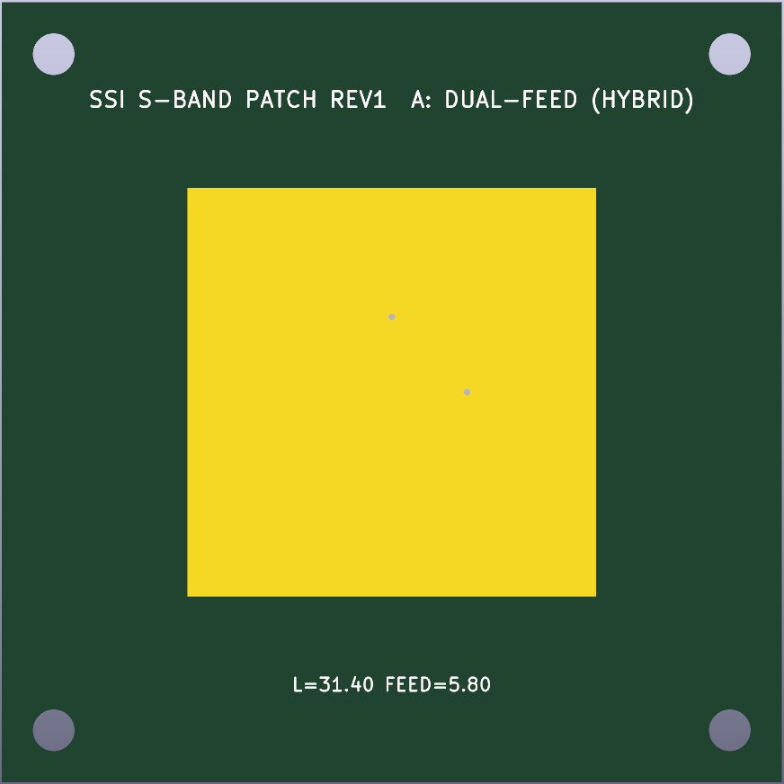 | 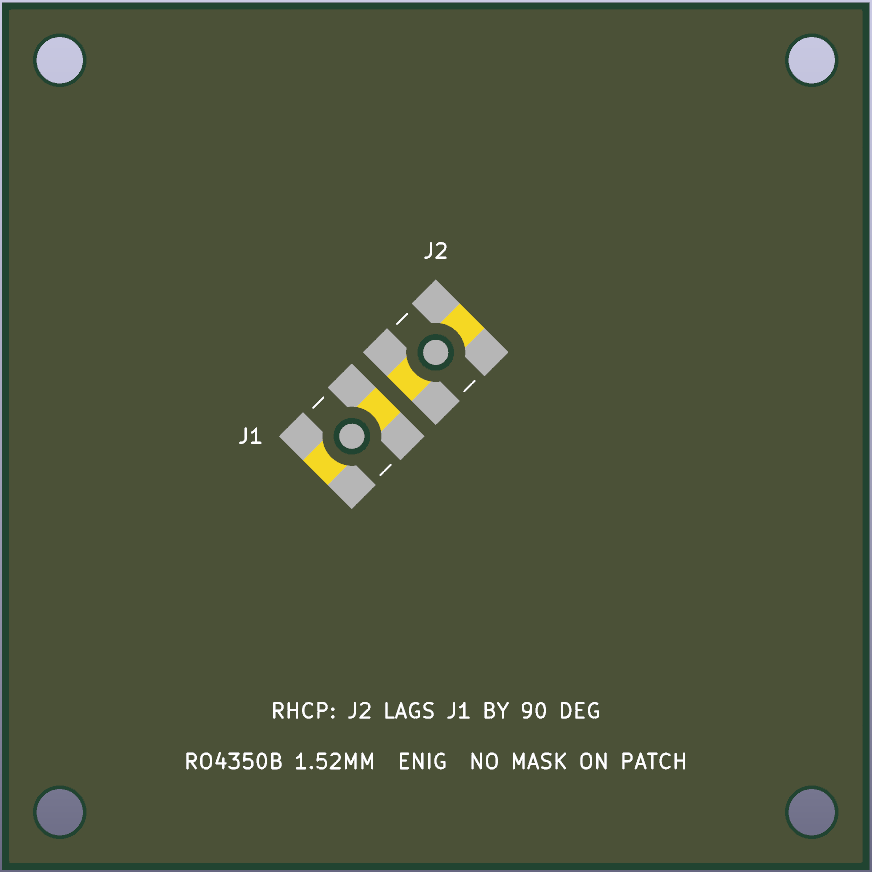 |
| **B: cut corner** (RO4350B) | 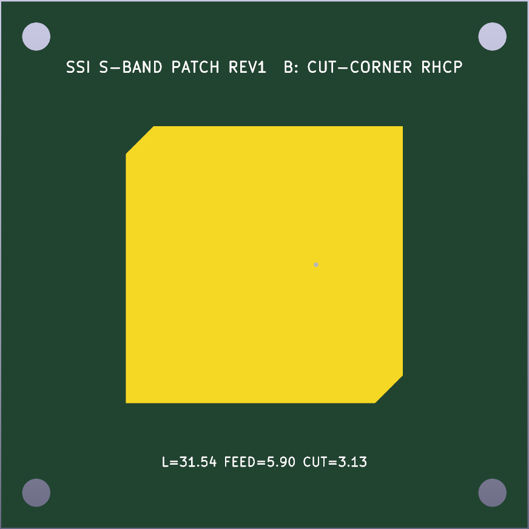 | 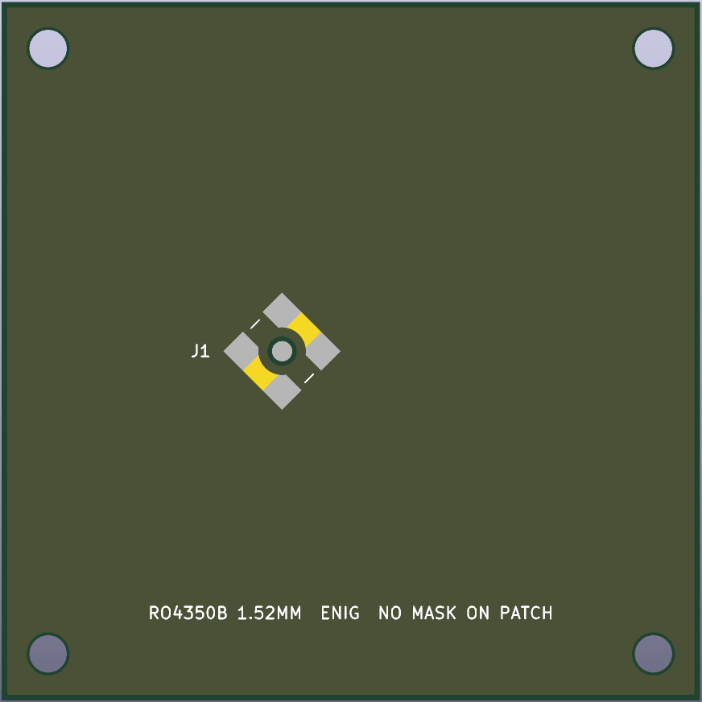 |
| **A-PTFE** | 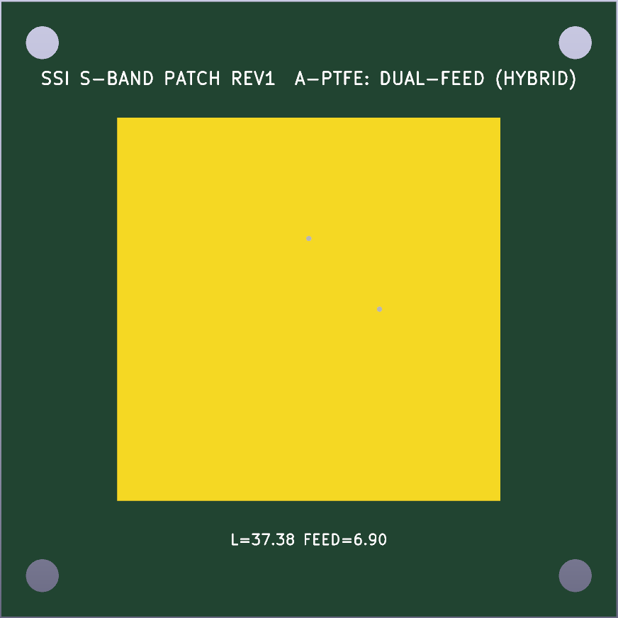 | 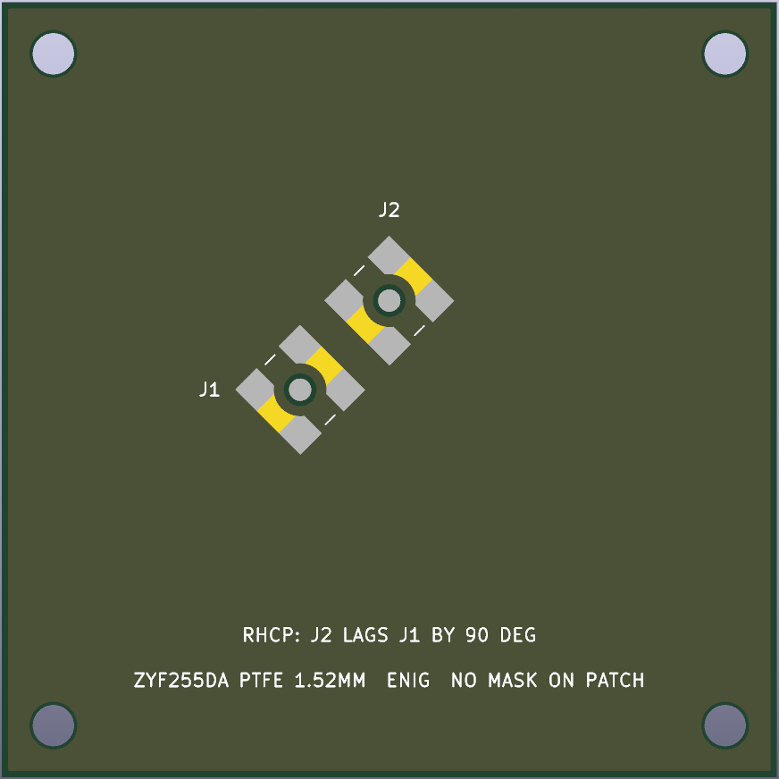 |
| **B-PTFE** | 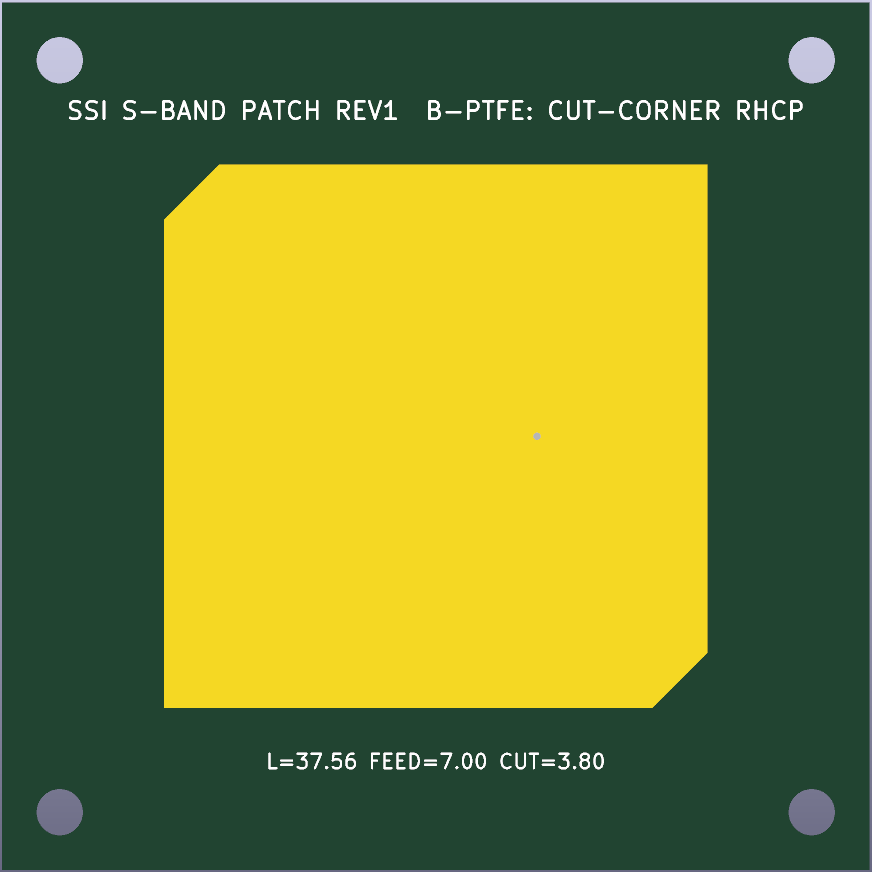 | 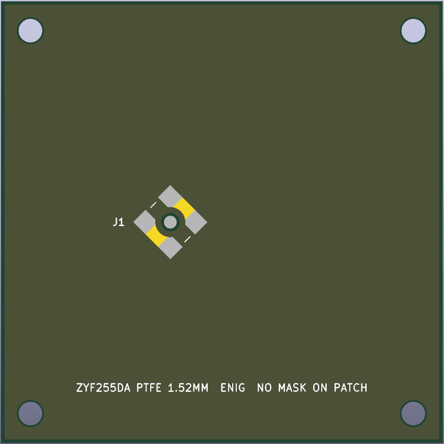 |

Simulated dimensions (mm):

| Board | Patch side | Feed offset from centre | Corner cut leg | Size variants built |
| --- | --- | --- | --- | --- |
| `A_dualfeed` | 31.40 | 5.80 | none | 31.10, 31.70 |
| `B_cutcorner_RHCP` | 31.54 | 5.90 | 3.13 | 31.24, 31.84 |
| `A_dualfeed_PTFE` | 37.38 | 6.90 | none | 37.08, 37.68 |
| `B_cutcorner_RHCP_PTFE` | 37.56 | 7.00 | 3.80 | 37.26, 37.86 |
| `B_cutcorner_RHCP_PTFE_face100` | 37.52 | 7.00 | 3.50 | 37.22, 37.82 |

`B_cutcorner_RHCP_PTFE_face100` looks the same as B-PTFE but is tuned for mounting flat on a 100 mm metal face. On that face it simulates at 0.2 dB best axial ratio at 2.425 GHz, 3.9 dB at the band edges, and 6.8–7.05 dBic. Use it only if the antenna really mounts that way.

Common to all:
- 60 × 60 mm, 2 layers, 1.52 mm core, ENIG.
- **Top:** only the patch, with no solder mask over it.
- **Bottom:** solid ground, M3 mounting holes 4 mm from each corner (placeholder positions).
- **Feed:** surface-mount vertical SMA (Würth WR-SMA 60312102114405) on the bottom, soldered flat to the ground so no legs pass through the patch. A 0.5 mm plated via under its centre pad is the probe up to the patch.
- **Board A:** J1 on the +x axis, J2 on the +y axis (up in the top view). **RHCP when J2 lags J1 by 90°**; this is printed on the back. It has no hybrid on the board: test it with an external connectorized 90° hybrid and two equal-length cables.
- **Board B:** top-left and bottom-right corners cut (top view). **Confirmed RHCP** two ways: from the simulated far field, and from the rotation of the raw field over time above the patch.
- The size variants cover frequency error: 0.3 mm of patch side is about 21 MHz on RO4350B and 19 MHz on PTFE.

## Simulation results

Solver: openEMS (FDTD). Details and the full run list are in [`sim/README.md`](sim/README.md); raw outputs are in [`sim/results_openems/`](sim/results_openems).

| Board | Plot |
| --- | --- |
| A, RO4350B | 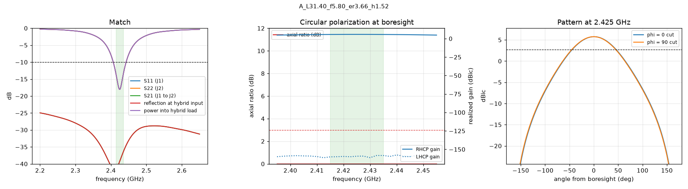 |
| B, RO4350B |  |
| A, PTFE | 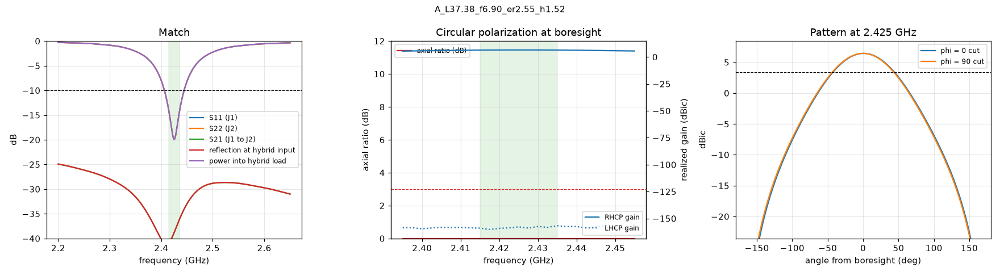 |
| B, PTFE | 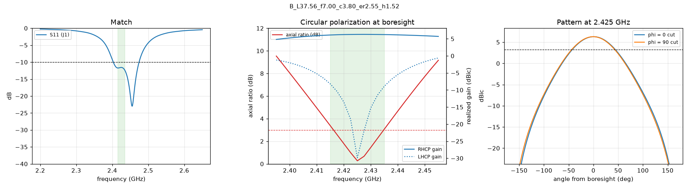 |

Detail (bare 60 mm board unless stated):

| | A, RO4350B | B, RO4350B | A, PTFE | B, PTFE |
| --- | --- | --- | --- | --- |
| Worst S11 in the 20 MHz band | −13.5 dB | −12.2 dB | −14.3 dB | −11.6 dB |
| −10 dB match bandwidth | 35.5 MHz | 69 MHz | 37.5 MHz | 71 MHz |
| Isolation between ports | −39 dB | n/a | −39 dB | n/a |
| Best axial ratio | hybrid-set | 0.2 dB | hybrid-set | 0.3 dB |
| Axial ratio ≤ 3 dB bandwidth | hybrid-set | about 15–18 MHz | hybrid-set | about 15–18 MHz |
| RHCP gain in band | 5.6–5.8 dBic | 5.5–5.7 dBic | 6.3–6.4 dBic | 6.1–6.3 dBic |
| RHCP gain on the 100 mm face | 5.9–6.0 dBic | 6.0–6.1 dBic | 6.8–6.9 dBic | 6.7–6.9 dBic |
| Half-power beamwidth (on the 100 mm face) | 88° (74–76°) | 88° (74–76°) | 84° (72–74°) | 84° (72–74°) |

### Sensitivity to board material (Dk off by ±1 %)

| | A, RO4350B | B, RO4350B | A, PTFE | B, PTFE |
| --- | --- | --- | --- | --- |
| Frequency shift | ±12.5 MHz | ±12.5 MHz | ±11.5 MHz | ±11.5 MHz |
| Worst S11 in band | −8.5 dB | −10 dB | −9.2 dB | −10.2 dB |
| Worst axial ratio in band | unaffected | 7.5 dB | unaffected | 6.8 dB |
| Lowest RHCP gain in band | 5.2 dBic | 4.8 dBic | 5.95 dBic | 5.6 dBic |

Board A tolerates material and temperature drift better: its polarization is set by the hybrid, so a frequency shift only costs some match. Board B's polarization degrades directly.

### Effect of the ground it's mounted on

A larger ground raises gain by about 0.5 dB and narrows the resonance (RO4350B match bandwidth 36 → 26 MHz). On the 100 mm face, board B's best axial ratio degrades from 0.2–0.3 dB to 1.3–1.5 dB because its corner cut was tuned for the bare board. **Board B needs re-tuning for the real mounting; board A does not.**

Re-tuning works as predicted: shrinking the PTFE board's cut from 3.80 to 3.50 mm (and the patch from 37.56 to 37.52 mm) brought the axial ratio on the 100 mm face back to 0.2 dB at 2.425 GHz.

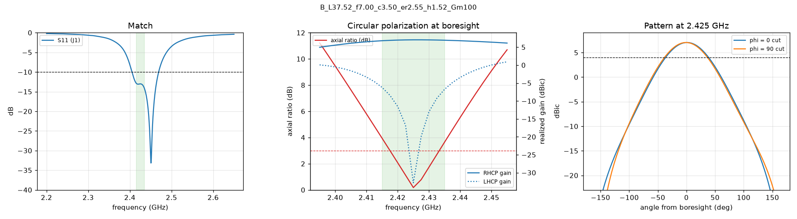

### What the simulation does and doesn't establish

- **Frequency accuracy is about ±1 %.** Two published measured patches on εr 2.5, 1.524 mm board simulate 0.4–0.9 % low: 41.4 × 41.0 mm (measured 2.228 GHz, simulated 2.208–2.217) and 41.4 × 68.58 mm (measured 2.200 GHz, simulated 2.185–2.192). The measured values were recalled from the literature, not re-read, so treat this as supporting evidence.
- **Real boards may therefore land 10–20 MHz high.** If so, the +0.3 mm variant of each board will be the one closest to 2.425 GHz. That's why the variants are worth ordering.
- **The hand formulas read about 2.7 % high** for these boards. They put the RO4350B patch at 32.12 mm; the simulation puts it at 31.40 mm. A finer mesh gives the same answer within 2.5 MHz.
- **Not modeled:** the SMA body, the via's true diameter (the probe is a thin wire, which overstates its inductance by roughly 6 Ω), solder mask, ENIG, a real hybrid, and the real satellite body.
- **PTFE inputs are JLC's listed values** (Dk 2.55, Df 0.0018), not measured ones.

## Design decisions

| Decision | Choice | Why |
| --- | --- | --- |
| Board size | 60 × 60 mm | Leaves 11–14 mm of ground around the patch |
| Thickness | 1.52 mm | Thickest single JLC option; more bandwidth and efficiency than thinner cores |
| Fab | JLC, 2-layer high-frequency | JLC offers RO4350B and its PTFE line as 2-layer only |
| Polarization | RHCP, IEEE convention, wave leaving the satellite | Confirmed by the team. The dish reflection flips the hand of the ground feed, so "RHCP" always means the transmitted wave |
| Circular polarization method | Build both: dual feed + hybrid (A) and cut corner (B) | A covers the full 20 MHz and tolerates drift; B is simpler but narrower |
| Hybrid location for rev 1 | Off the board (external) | A 2-layer board has no clean layer for the hybrid and its feed lines. Where it lives is a rev-2 decision |
| Connector | Surface-mount vertical SMA | Threaded and the CubeSat norm; surface-mount so nothing passes through the patch. It sticks out about 10 mm behind the board |

Polarization loss against a perfectly circular ground antenna, by axial ratio:

| Axial ratio | 1 dB | 3 dB | 6 dB | 10 dB | linear |
| --- | --- | --- | --- | --- | --- |
| Loss | 0.01 dB | 0.13 dB | 0.45 dB | 1.04 dB | 3 dB |

## How to

### Regenerate the boards

Install KiCad 10, then run its bundled Python:

```bash
"C:\Program Files\KiCad\10.0\bin\python.exe" kicad/generate_boards.py
```

On macOS use `/Applications/KiCad/KiCad.app/Contents/Frameworks/Python.framework/Versions/Current/bin/python3`.

Every dimension lives in `BOARDS` / `COMMON` at the top of `kicad/generate_boards.py`. The script rebuilds each board, refills the ground, runs DRC and updates `docs/renders/`. Options:
- `--variants -0.3 0.3` builds patch-size variants.
- `--gerbers` writes JLC zips to `fab/`.
- `--only A_dualfeed` builds one board.

Hand edits to the `.kicad_pcb` files are overwritten on the next run.

### Simulate

See [`sim/README.md`](sim/README.md).

### Order from JLC

Upload each zip from [`fab/`](fab), then set:
- **Material:** Rogers RO4350B, or PTFE ZYF255DA for the `_PTFE` boards
- **Thickness:** 1.52 mm
- **Layers:** 2
- **Surface finish:** ENIG
- **Copper:** 1 oz
- **Via-in-pad:** ask for the probe via under the SMA centre pad to be filled and capped. Otherwise hand-solder carefully so solder doesn't wick down the via.

Each design has three zips: nominal, −0.3 mm and +0.3 mm. Order about 5 of each version you want to test.

### Test (on a VNA)

| Test | How |
| --- | --- |
| Match | S11 at each port; S21 between board A's two ports |
| Circular polarization | Rotate a linear antenna in front of the patch and record received power. Less variation means better circular polarization |
| Hand | A known RHCP antenna should receive far more than an LHCP one |
| Gain (rough) | Compare against a known antenna |

Stand the board on M3 standoffs: the SMA sticks out the back.

## Open items

| Item | Owner |
| --- | --- |
| **Board material:** RO4350B (heritage, 5.9–6.3 dBic) or PTFE ZYF255DA (6.6–7.2 dBic, no outgassing data found) | Gabriel / TT&C lead |
| Is 6.5 dBic a hard requirement? The link budget assumed 5 dBi | Mission Control |
| Exact carrier frequency and signal bandwidth (design assumes 2.425 GHz, 20 MHz) | TT&C lead |
| How the antenna mounts: which face, what metal is behind it, depth available for the SMA and cable | Structures / GNC |
| Mounting-hole pattern (M3 at 4 mm from the corners is a placeholder) | Structures |
| Hybrid location and part for rev 2 | TT&C lead |
| A connectorized 2.4 GHz 90° hybrid and two equal-length SMA cables for bench testing | TT&C lead / lab |
| Outgassing data for ZYF255DA, if PTFE is chosen | Gabriel |
| Solder mask on the top side: HFSS shows mask around the patch shifts the tuning by about −6 to −8 MHz ([`sim/HFSS_RESULTS.md`](sim/HFSS_RESULTS.md)). Ask JLC whether the top can be left free of mask | Gabriel |

## Reference design

Samsuzzaman et al., ["Right hand circularly polarized 2.40 GHz truncated corner patch antenna for small satellite application"](https://joam.inoe.ro/articles/right-hand-circularly-polarized-240-ghz-truncated-corner-patch-antenna-for-small-satellite-application/fulltext) (JOAM).

- Same as ours: 2.40 GHz, a single square patch over a ground plane, cut corners, a coax probe from behind, about 6.7 dBi, designed in HFSS, built and measured on a VNA.
- Different from ours: Rogers RT5880 (a PTFE laminate, εr 2.2), and a narrow channel with an axial-ratio bandwidth of about 2 MHz. Their gain on a low-loss PTFE board is consistent with the PTFE results here.
