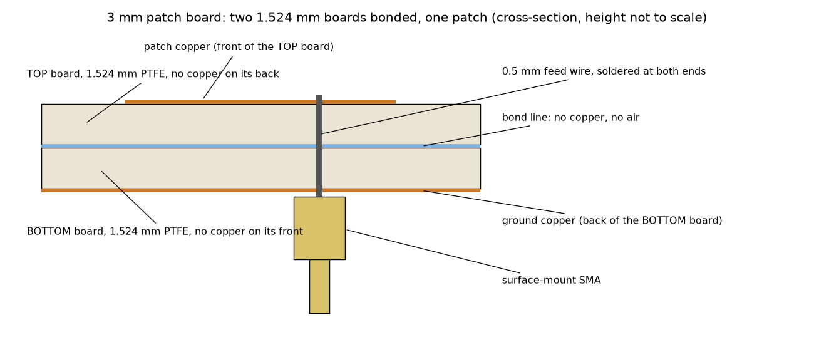

# Prototype: 3 mm patch boards

**Status: prototype, not ordered.** Gerbers are in `fab/` (one zip per board, four in all). The boards were regenerated with KiCad 10 on 24 November 2026 and pass DRC, apart from KiCad's note that the feed hole sits inside the SMA footprint, which is intended. The rev-1 boards are unchanged. The dimensions come from simulation only, and the open points below are not settled.

## What this is

JLC sells the PTFE (ZYF255DA) as a 1.524 mm two-layer board. A patch on a board twice as thick has about twice the bandwidth and about 0.4 to 0.5 dB more gain (see [`docs/results_60mm/`](../../docs/results_60mm/README.md) and [`sim/results_hfss/thick_tables.md`](../../sim/results_hfss/thick_tables.md)). So each antenna here is built from two 1.524 mm boards bonded face to face, with one patch on top:



| Folder | What is on it |
| --- | --- |
| `B_cutcorner_RHCP_PTFE_3mm_TOP` | Cut-corner patch on the front. No copper on the back. No solder mask and no silkscreen on the front. |
| `B_cutcorner_RHCP_PTFE_3mm_BOTTOM` | No copper on the front. Ground plane and one SMA on the back. |
| `A_dualfeed_PTFE_3mm_TOP` | Square patch on the front. No copper on the back. No solder mask and no silkscreen on the front. |
| `A_dualfeed_PTFE_3mm_BOTTOM` | No copper on the front. Ground plane and two SMAs on the back. |

Each folder has the KiCad board and an SVG picture. The BOTTOM pictures are drawn as seen from the back. All four boards report `DRC clean`.

## Dimensions

| | Cut corner (B-3MM) | Dual feed (A-3MM) |
| --- | --- | --- |
| Board | 60 mm square, M3 holes 4 mm in from each edge | same |
| Patch side | 37.10 mm | 36.39 mm |
| Corner cut | 5.55 mm, top-left and bottom-right in the top view | none |
| Feed | 8.00 mm right of centre and 2.18 mm up | J1 6.70 mm right of centre, J2 6.70 mm above centre |
| Feed hole | 0.6 mm, for a 0.5 mm wire | same |
| Connector | Würth 60312102114405 surface-mount SMA | two of the same |

The cut-corner feed sits 2.18 mm off the centre line on purpose. The feed wire through 3 mm of board adds inductance, and the sideways offset cancels it.

On the dual feed, RHCP needs J2 to lag J1 by 90°, the same as the rev-1 board A. The coupler is still an external part.

## How it goes together

1. Bond the TOP board onto the BOTTOM board with a thin, even layer of adhesive, using the four M3 holes to line them up. There must be no air between them.
2. Solder the SMA to the back of the BOTTOM board.
3. Pass a 0.5 mm wire through the feed hole in both boards. Solder it to the SMA centre pad at the back and to the patch at the front, and trim it flush.

## Open points before any order

- **The bond matters more than anything else in the build.** In simulation a 0.05 mm air film between the boards moves the cut corner's axial ratio from 2.2 dB to 6.5 dB, and a 0.10 mm air film detunes the dual feed by about 49 MHz. A 0.05 mm adhesive layer of Dk 3.0 changes little (cut corner 2.6 dB). Screws alone will not guarantee zero air. The adhesive, its thickness and its Dk are not chosen.
- **The feed hole is plated but has a pad on one face only**, so that both bond faces stay bare and flat. JLC may ask about a plated hole with no pad on one side. The alternative is an unplated hole in both boards; the wire carries the signal either way.
- **Each board has copper on one side only.** Check that JLC will build ZYF255DA with one side fully etched.
- **The cut corner is still sensitive to tolerances.** With Dk ±1.2 % or the patch ±0.3 mm its axial ratio goes to 4.2 to 5.6 dB. If it is built, it needs −0.3 and +0.3 mm variants like rev 1. These are not drawn.
- **The two bond faces still get solder mask** (the back of each TOP board and the front of each BOTTOM board), because that is the factory default. That puts two thin mask layers in the joint as well as the adhesive, which the simulation does not include. Bare laminate would match the model better, but adhesive may hold less well on bare PTFE. Decide this with whoever does the bonding; removing the mask is a one-line change in `prototype_thick.py`.
- **The labels are on the BOTTOM boards only.** The TOP boards have no silkscreen, since ink cannot sit in a mask opening and their back is a bond face. Tell them apart by the patch: clipped corners on the cut corner, plain square on the dual feed.
- **These files are now in KiCad 10 format.** KiCad 8 and 9 cannot open them.
- **The simulation has a 0.5 mm feed pin and no SMA, solder mask or adhesive.** On the thin board the SMA moved the result by −2.5 to −4 MHz and solder mask by −6 to −8 MHz (`sim/HFSS_RESULTS.md`). Neither check has been repeated at this thickness. The cut corner's axial-ratio window has about ±6 MHz to spare, so those shifts matter for it.

## Regenerating

```
"C:\Program Files\KiCad\10.0\bin\python.exe" kicad/prototype_thick.py --gerbers
```

On macOS use `/Applications/KiCad/KiCad.app/Contents/Frameworks/Python.framework/Versions/Current/bin/python3`. Without `--gerbers` only the boards and pictures are rebuilt.

Dimensions are read from [`sim/thick_design.json`](../../sim/thick_design.json).
