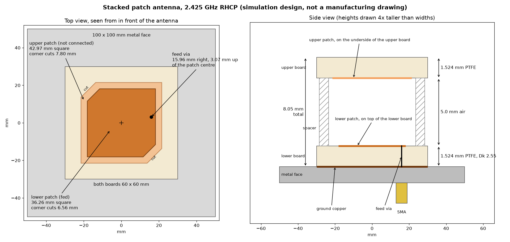

# Stacked patches and the board-size sweep

Run in Ansys HFSS (Electronics Desktop Student 2025 R2) on 19 and 20 November 2026. Everything here is simulation. Nothing has been built or measured.

All four antennas use JLC's PTFE (ZYF255DA, Dk 2.55, 1.524 mm) and are tuned for 2.425 GHz with a 20 MHz channel (2.415 to 2.435 GHz). Unless a table says otherwise, the board is 60 mm square on a 100 mm metal face, and the mesh is about 40,000 elements.

## Summary

- **There are now four tuned antennas:** cut corner, dual feed, stacked cut corner and stacked dual feed. The two stacked ones are new.
- **Stacking adds about 1.4 to 1.5 dB of gain and widens every window by about three times.** The cost is a second board held 5.0 mm above the first, which makes the antenna about 8 mm tall instead of 1.5 mm.
- **On the stacked patch, the dual feed is not better than the cut corner.** With a typical coupler its axial ratio is about the same (1.48 against 1.39 dB), its gain is 0.2 dB lower, and it needs a coupler, a load and a second line.
- **Board size barely changes anything when the board sits on the 100 mm metal face.** From 50 to 100 mm, gain moves by less than 0.1 dB and beamwidth by less than 1 degree for all four. The one exception is the stacked cut corner at 50 mm, where the axial ratio rises to 3.34 dB.
- **Hand calculations agree with HFSS** within 3 % on patch size and within 10 % on bandwidth for all four. See [`HAND_CALCS.md`](HAND_CALCS.md).

## 1. The four antennas side by side


| | Cut corner | Dual feed | Stacked cut corner | Stacked dual feed | Requirement |
| --- | --- | --- | --- | --- | --- |
| Worst S11 in the channel | −15.5 dB | −13.6 dB | −12.7 dB | −19.2 dB | −10 dB or lower |
| −10 dB match window | 66 MHz | 32 MHz | 206 MHz | 106 MHz | covers the channel |
| Worst axial ratio in the channel | 4.14 dB | 0.79 dB | 1.39 dB | 1.48 dB | 3 dB or lower |
| 3 dB axial-ratio window | 16 MHz | set by the coupler | 49 MHz | set by the coupler | 20 MHz or more |
| RHCP gain in the channel | 7.08 to 7.24 dBic | 6.75 to 6.96 dBic | 8.49 to 8.56 dBic | 8.28 to 8.34 dBic | 6.5 dBic or more |
| Half-power beamwidth | 72° | 72° | 66° | 66° | 60° or wider |
| Height | 1.5 mm | 1.5 mm | 8.0 mm | 8.0 mm | |
| Extra parts | none | coupler, load, second line | second board, spacers | all of those | |

The two dual-feed columns assume a typical 90° coupler (0.5 dB and 3° off, 0.4 dB loss). With a perfect coupler their axial ratio would be 0.1 dB and 0.9 dB.

What the rows mean, briefly:

- **S11** is how much of the transmitter's power bounces back from the antenna. −10 dB means 10 % bounces back.
- **Axial ratio** is how round the circular polarization is. 0 dB is a perfect circle. At 3 dB about 0.13 dB of signal is lost to a perfectly circular ground antenna.
- **Gain** is how much the antenna concentrates power straight ahead.

The single cut corner misses the 3 dB axial-ratio limit at the channel edges (4.14 dB) because its axial-ratio window is 16 MHz and the channel is 20 MHz. It meets the limit over the middle 16 MHz.

## 2. The stacked patch



A second, slightly larger patch sits on its own board 5.0 mm above the fed patch. Only the lower patch has a feed. The upper patch is excited through the air gap.

| Dimension | Stacked cut corner | Stacked dual feed |
| --- | --- | --- |
| Lower patch side | 36.26 mm | 35.04 mm |
| Lower patch corner cut | 6.56 mm | none |
| Feed distance from centre | 15.96 mm | 13.35 mm (both feeds) |
| Feed sideways offset | 3.07 mm | none |
| Upper patch side | 42.97 mm | 41.51 mm |
| Upper patch corner cut | 7.80 mm | none |
| Air gap | 5.0 mm | 5.0 mm |
| Upper board | 1.524 mm PTFE, patch on the underside | same |

What the tuning found:

- **The two patches act as one wide resonator.** The stack has two resonances about 500 MHz apart at any practical gap. The design uses the lower one. Its bandwidth is about three times a single patch's.
- **The feed has to sit near the patch edge.** The stack's resistance at resonance is lower than a single patch's, so the 50 Ω point moves outward.
- **The feed pin's own inductance limits the match** on the cut-corner version. Moving the feed 3.07 mm sideways cancels most of it. Worst S11 is −12.7 dB, which passes with 2.7 dB to spare.
- **The fine mesh read 17 MHz higher than the tuning mesh**, so the final dimensions were scaled by 0.7 % and re-solved.

The 5.0 mm gap was chosen as a practical spacer height. It was not optimised.

## 3. Board-size sweep, on the 100 mm metal face

The patch dimensions stay fixed. Only the board (both boards, for the stacked designs) changes from 50 to 100 mm square. The metal face behind it stays 100 mm.


| Board side | Cut corner gain | Dual feed gain | Stacked cut corner gain | Stacked dual feed gain |
| --- | --- | --- | --- | --- |
| 50 mm | 7.05 dBic | 6.74 dBic | 8.43 dBic | 8.17 dBic |
| 60 mm | 7.08 dBic | 6.75 dBic | 8.49 dBic | 8.28 dBic |
| 70 mm | 7.05 dBic | 6.75 dBic | 8.44 dBic | 8.28 dBic |
| 80 mm | 7.00 dBic | 6.72 dBic | 8.44 dBic | 8.25 dBic |
| 90 mm | 7.03 dBic | 6.70 dBic | 8.41 dBic | 8.22 dBic |
| 100 mm | 7.00 dBic | 6.68 dBic | 8.39 dBic | 8.18 dBic |

Gain is the lowest RHCP gain in the channel. Dual-feed figures include 0.4 dB coupler loss.

| Board side | Cut corner AR | Dual feed AR | Stacked cut corner AR | Stacked dual feed AR |
| --- | --- | --- | --- | --- |
| 50 mm | 3.77 dB | 0.77 dB | 3.34 dB | 1.37 dB |
| 60 mm | 4.14 dB | 0.79 dB | 1.39 dB | 1.48 dB |
| 70 mm | 4.05 dB | 0.73 dB | 1.59 dB | 1.48 dB |
| 80 mm | 3.83 dB | 0.80 dB | 1.71 dB | 1.46 dB |
| 90 mm | 4.06 dB | 0.74 dB | 1.78 dB | 1.49 dB |
| 100 mm | 4.00 dB | 0.76 dB | 1.84 dB | 1.52 dB |

AR is the worst axial ratio in the channel.

What the sweep shows:

- **Gain falls slightly as the board grows:** about 0.05 to 0.1 dB from 60 to 100 mm for all four. More dielectric around the patch holds a little more energy near the surface.
- **Match and beamwidth do not move in any way that matters.** Worst S11 stays within 1.3 dB of the 60 mm value except for the stacked dual feed, which varies from −16.1 to −19.2 dB and always passes. Beamwidth changes by less than 1°.
- **The single patches' polarization does not care about board size.** The cut corner's worst axial ratio wanders between 3.77 and 4.14 dB with no trend. That scatter (about ±0.2 dB) is the mesh, not the board.
- **The stacked cut corner's polarization does care.** Above 60 mm its axial ratio rises slowly, from 1.39 to 1.84 dB, as its best-polarization frequency slides 5 MHz low. At 50 mm it rises to 3.34 dB because that frequency jumps 15 MHz high. The 43 mm upper patch has only 3.5 mm of board around it at 50 mm, so its edge fields lose dielectric and the patch resonates higher. A 50 mm version would need its patches made about 0.6 % larger. That re-tune was not done.
- **The stacked dual feed is not affected** at 50 mm, because its polarization comes from the coupler and not from the patch's exact frequency.

The reason board size matters so little here is that the 100 mm metal face is the ground plane in every case. The board size only changes how much dielectric surrounds the patch. Section 4 removes the metal face, so the ground plane shrinks with the board.

Full tables with S11, directivity, efficiency and beamwidth for every size are in [`results_hfss/sweep_tables.md`](results_hfss/sweep_tables.md).

## 4. Board-size sweep, no metal behind the board

PENDING_BARE

## 5. Stress tests on the stacked cut corner

PENDING_STRESS

## 6. Hand calculations

[`HAND_CALCS.md`](HAND_CALCS.md) has every formula, input and result. [`hand_calcs.py`](hand_calcs.py) reproduces the numbers.

| Quantity | Hand calculation | HFSS | Difference |
| --- | --- | --- | --- |
| Single dual-feed patch side | 38.25 mm | 37.28 mm | +2.6 % |
| Single cut-corner patch side | 38.43 mm | 37.52 mm | +2.4 % |
| Single cut-corner axial-ratio window | 15.8 MHz | 16.0 MHz | −1 % |
| Single cut-corner match window | 64.1 MHz | 65.8 MHz | −3 % |
| Single dual-feed match window | 32.1 MHz | 32.4 MHz | −1 % |
| Stacked cut-corner axial-ratio window | 47.3 MHz | 49.4 MHz | −4 % |
| Stacked cut-corner match window | 192 MHz | 206 MHz | −7 % |
| Stacked cut size, as a fraction of patch area | 0.174 | 0.181 | −4 % |
| Stacked dual-feed lower patch side | 35.19 mm | 35.04 mm | +0.4 % |
| Stacked dual-feed upper patch side | 41.72 mm | 41.51 mm | +0.5 % |
| Stacked dual-feed feed position | 13.45 mm | 13.35 mm | +0.8 % |
| Stacked dual-feed match window | 96 MHz | 106 MHz | −10 % |
| Stacked dual-feed gain at the patch | 8.77 dBic | 8.74 dBic | +0.03 dB |
| Stacked dual-feed axial ratio, typical coupler | 0.68 dB | 1.48 dB | −0.8 dB |

The stacked hand calculations take the coupling between the two patches (about 19 to 20 %) from a first HFSS mapping run. They are a check on the tuning, not an independent prediction of it.

The one real disagreement is the last row. The hand formula assumes the two feeds are isolated from each other. On the stacked patch they are coupled at −27 dB (against −45 dB on the single patch), and that adds about 0.8 dB of axial ratio.

## 7. What this does not show

- **Nothing has been built or measured.** HFSS agreed with openEMS within 0.4 % in frequency on the single patches. Neither has been checked against a real board from this project.
- **The stacked designs were solved at one mesh size** (about 40,000 elements, near the Student licence's 64,000 limit). Run-to-run scatter is about ±0.2 dB in axial ratio and ±0.03 dB in gain.
- **The spacers and screws that hold the upper board are not designed.** Section 5 tests their electrical effect only.
- **The coupler for the dual-feed designs is not designed.** Its error and loss are assumed typical values.
- **The 5.0 mm gap was not optimised**, and the allowed antenna height on the satellite is not confirmed.
- **2.425 GHz is still an assumed carrier.**
- **The KiCad boards and Gerbers are unchanged.** No stacked board has been drawn.

## How to reproduce

```
python sim/hfss_batch.py --only SZ  --mesh 40000   # board sizes on the 100 mm face
python sim/hfss_batch.py --only SZB --mesh 40000   # board sizes with no metal behind
python sim/hfss_batch.py --only TS  --mesh 40000   # stacked cut corner: nominal, Dk, patch size
python sim/hfss_batch.py --only TSK --mesh 40000   # stacked cut corner: gap, misalignment, spacers
python sim/hfss_batch.py --only TSD --mesh 40000   # stacked dual feed
python sim/sweep_report.py                          # plots and tables
python sim/hand_calcs.py                            # hand calculations
```
