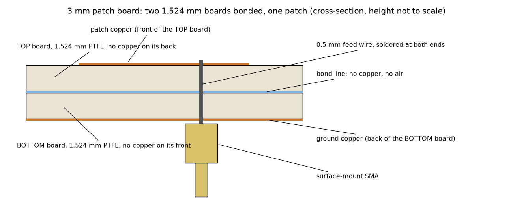
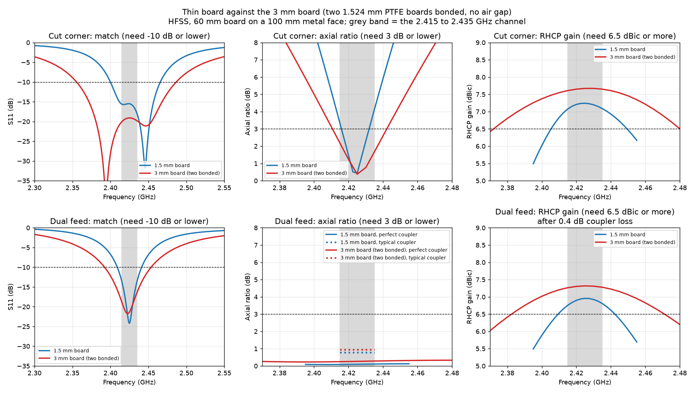

# 3 mm board: two bonded boards, one patch

Run in Ansys HFSS (Electronics Desktop Student 2025 R2) on 20 to 23 November 2026. Everything here is simulation. Nothing has been built or measured.

JLC sells the PTFE (ZYF255DA, Dk 2.55) as a 1.524 mm board. This note covers a patch on a board twice as thick, made by bonding two of those boards face to face with **no air between them** and putting one patch on top. This is different from the air-gap stack in [`STACKED_AND_SIZE_SWEEP.md`](STACKED_AND_SIZE_SWEEP.md), which holds two boards apart and has a patch on each.



Both antennas were re-tuned for the 3.05 mm thickness: 2.425 GHz, 20 MHz channel (2.415 to 2.435 GHz), 60 mm square board on a 100 mm metal face, about 40,000 mesh elements.

## Summary

- **Both 3 mm antennas meet all four requirements at their nominal dimensions.** The thin cut corner does not (its axial ratio is 4.14 dB at the channel edges).
- **Doubling the thickness adds about 0.4 to 0.5 dB of gain and doubles every bandwidth.** Less power is lost in the copper and the board (efficiency 87 % to 95 %).
- **The 3 mm dual feed tolerates manufacturing error; the 3 mm cut corner still does not.** With the board's Dk off by 1.2 % or the patch off by 0.3 mm, the dual feed passes three of four cases and just misses the fourth. The cut corner's axial ratio goes to 4.2 to 5.6 dB in all four, although its gain stays at 7.3 dBic or more.
- **Air between the two boards is the main build risk.** Each 0.01 mm of air film raises the frequency by about 5 MHz. The dual feed tolerates 0.02 mm and just fails at 0.05 mm. The cut corner fails at 0.02 mm. A 0.05 mm layer of adhesive (Dk 3.0) instead of air changes little for either.
- **Hand calculations agree with HFSS** within about 3 % on patch size and 5 % on bandwidth. See section 5 of [`HAND_CALCS.md`](HAND_CALCS.md).
- **Prototype KiCad boards are drawn** in [`kicad/prototype_thick/`](../kicad/prototype_thick/). No Gerbers have been exported and nothing has been ordered.

## 1. Thin board against the 3 mm board



| | Cut corner, thin | Cut corner, 3 mm | Dual feed, thin | Dual feed, 3 mm | Requirement |
| --- | --- | --- | --- | --- | --- |
| Board thickness | 1.5 mm | 3.0 mm | 1.5 mm | 3.0 mm | |
| Worst S11 in the channel | −15.5 dB | −19.1 dB | −13.6 dB | −16.4 dB | −10 dB or lower |
| −10 dB match window | 66 MHz | 131 MHz | 32 MHz | 63 MHz | covers the channel |
| Worst axial ratio in the channel | 4.14 dB | 2.17 dB | 0.79 dB | 0.94 dB | 3 dB or lower |
| 3 dB axial-ratio window | 16 MHz | 32 MHz | set by the coupler | set by the coupler | 20 MHz or more |
| RHCP gain in the channel | 7.08 to 7.24 dBic | 7.61 to 7.67 dBic | 6.75 to 6.96 dBic | 7.26 to 7.32 dBic | 6.5 dBic or more |
| Half-power beamwidth | 72° | 73° | 72° | 73° | 60° or wider |
| Radiation efficiency | 87 % | 95 % | 87 % | 95 % | |
| Meets all four | no | yes | yes | yes | |
| Extra parts | none | second board, bonded | coupler, load, second line | all of those | |

The dual-feed columns assume a typical 90° coupler (0.5 dB and 3° off, 0.4 dB loss). With a perfect coupler the axial ratio would be 0.11 dB (thin) and 0.28 dB (3 mm). The dual feed has no axial-ratio window of its own: its polarization is made by the coupler, which works over a far wider band than the channel.

Separate plots for each antenna are in [`docs/results_60mm/`](../docs/results_60mm/README.md).

**Why thicker helps.** A patch antenna is the gap between the patch and the ground plane. A taller gap radiates more easily, so less energy is stored for the same radiated power. That halves the antenna's Q (53 to 28 by hand calculation), which doubles the bandwidths, and it halves the share of power lost in the copper and the board.

## 2. Tuned dimensions

| | Cut corner, 3 mm | Dual feed, 3 mm |
| --- | --- | --- |
| Patch side | 37.10 mm | 36.39 mm |
| Corner cut | 5.55 mm, top-left and bottom-right in the top view | none |
| Feed | 8.00 mm right of centre and 2.18 mm up | J1 6.70 mm right of centre, J2 6.70 mm above centre |
| Feed pin | 0.5 mm, through both boards | same |
| HFSS run | `B_L37.10_f8.00_c5.55_fy2.18_er2.55_h3.05_Gm100_mesh40k` | `A_L36.39_f6.70_er2.55_h3.05_Gm100_mesh40k` |

The cut-corner feed sits 2.18 mm off the centre line on purpose. A feed pin through 3 mm of board has about twice the inductance of the thin board's (the feed read 54 + 31j Ω on the centre line). Moving the feed sideways cancels that reactance, the same fix used on the air-gap stack. It also drives the patch's two modes unequally, so the corner cut has to be larger than the plain formula gives (5.55 mm against 5.0 mm).

On the dual feed, RHCP needs J2 to lag J1 by 90°, the same as the thin board. The isolation between the two feeds is −36 dB (−46 dB on the thin board).

## 3. Stress tests

Each cell is worst S11, worst axial ratio, RHCP gain in the channel. A case passes if S11 is −10 dB or lower, axial ratio is 3 dB or lower and gain is 6.5 dBic or more.

**Cut corner**

| Case | Thin board | | 3 mm board | |
| --- | --- | --- | --- | --- |
| Dk 2.52 (−1.2 %) | −10.0 dB, 8.44 dB, 6.09 to 7.25 dBic | fail | −19.8 dB, 4.57 dB, 7.45 to 7.70 dBic | fail |
| Dk 2.58 (+1.2 %) | −14.8 dB, 8.69 dB, 6.53 to 7.14 dBic | fail | −18.8 dB, 4.15 dB, 7.49 to 7.67 dBic | fail |
| Patch 0.3 mm smaller | −8.0 dB, 10.40 dB, 5.48 to 7.09 dBic | fail | −21.1 dB, 5.64 dB, 7.33 to 7.66 dBic | fail |
| Patch 0.3 mm larger | −15.9 dB, 10.55 dB, 6.20 to 7.01 dBic | fail | −19.1 dB, 5.32 dB, 7.36 to 7.66 dBic | fail |
| 0.02 mm air film between the boards | does not apply | | −19.9 dB, 3.90 dB, 7.52 to 7.71 dBic | fail |
| 0.05 mm air film between the boards | does not apply | | −23.7 dB, 6.51 dB, 7.23 to 7.64 dBic | fail |
| 0.05 mm adhesive layer, Dk 3.0 | does not apply | | −19.4 dB, 2.59 dB, 7.62 to 7.68 dBic | pass |

**Dual feed** (typical coupler)

| Case | Thin board | | 3 mm board | |
| --- | --- | --- | --- | --- |
| Dk 2.52 (−1.2 %) | −7.4 dB, 0.77 dB, 6.07 to 6.96 dBic | fail | −13.0 dB, 0.91 dB, 7.08 to 7.33 dBic | pass |
| Dk 2.58 (+1.2 %) | −7.1 dB, 0.78 dB, 6.06 to 6.89 dBic | fail | −11.2 dB, 0.97 dB, 7.06 to 7.30 dBic | pass |
| Patch 0.3 mm smaller | −5.8 dB, 0.77 dB, 5.58 to 6.77 dBic | fail | −11.2 dB, 0.95 dB, 6.95 to 7.29 dBic | pass |
| Patch 0.3 mm larger | −5.8 dB, 0.73 dB, 5.69 to 6.80 dBic | fail | −9.7 dB, 0.96 dB, 6.94 to 7.29 dBic | fail |
| 0.02 mm air film between the boards | does not apply | | −14.0 dB, 0.90 dB, 7.13 to 7.34 dBic | pass |
| 0.05 mm air film between the boards | does not apply | | −9.8 dB, 0.88 dB, 6.83 to 7.27 dBic | fail |
| 0.10 mm air film between the boards | does not apply | | −6.0 dB, 0.93 dB, 6.09 to 6.81 dBic | fail |
| 0.05 mm adhesive layer, Dk 3.0 | does not apply | | −14.2 dB, 0.93 dB, 7.20 to 7.31 dBic | pass |

What the tables show:

- **The same errors shift the frequency by about the same amount on both thicknesses** (about 13 MHz for Dk ±1.2 %, about 19 MHz for ±0.3 mm). The 3 mm boards cope better only because their windows are twice as wide.
- **The 3 mm cut corner fails on axial ratio alone.** Its window is 32 MHz and the channel is 20 MHz, which leaves about ±6 MHz for error. Its match and gain pass in every case. An axial ratio of 4.2 to 5.6 dB loses about 0.2 to 0.4 dB of signal to a perfectly circular ground antenna.
- **The 3 mm dual feed's two failures are near misses on match** (−9.7 and −9.8 dB against −10 dB), and its gain stays at 6.8 dBic or more in both.
- **0.3 mm is a harsh size error.** It is the step between the rev-1 size variants, not a measured etching tolerance.

## 4. The bond between the two boards

The two boards act as one only if nothing but board material sits between the patch and the ground. A film of air there lowers the average Dk, which raises the frequency.

| Layer between the boards | Frequency shift | Cut corner: worst axial ratio | Dual feed: worst S11 |
| --- | --- | --- | --- |
| none (nominal) | 0 | 2.17 dB | −16.4 dB |
| 0.02 mm air | about +10 MHz | 3.90 dB | −14.0 dB |
| 0.05 mm air | about +24 MHz | 6.51 dB | −9.8 dB |
| 0.10 mm air | about +49 MHz | not run | −6.0 dB |
| 0.05 mm adhesive, Dk 3.0 | about −5 MHz | 2.59 dB | −14.2 dB |

- **Air is the problem, not the extra thickness.** 0.05 mm of adhesive with a Dk near the board's moves the frequency by about 5 MHz; 0.05 mm of air moves it by about 24 MHz.
- **Screws alone are unlikely to be enough.** The boards have to be bonded over the whole face, at least under the patch. The adhesive, its thickness and its Dk are not chosen, and the simulated adhesive Dk of 3.0 is an assumed typical value.
- **Bare bond faces.** Neither board has copper on the face that is bonded, so there is no 0.035 mm copper step to trap air. The prototype boards are drawn that way.

**How these were simulated.** The field under a patch runs straight from patch to ground, so a thin layer in the stack behaves like a capacitor in series with the boards. The layer was therefore folded into one uniform substrate of the total thickness with the series-averaged Dk (for example 0.05 mm of air: 3.098 mm at Dk 2.488). This is a standard approximation and ignores the fringing field at the patch edge. A film that covers only part of the face was not simulated.

## 5. Against the air-gap stack

| | Cut corner, 3 mm board | Dual feed, 3 mm board | Stacked cut corner, 3 mm gap | Stacked cut corner, 5 mm gap |
| --- | --- | --- | --- | --- |
| Height | 3.0 mm | 3.0 mm | 6.0 mm | 8.0 mm |
| RHCP gain in the channel | 7.61 to 7.67 dBic | 7.26 to 7.32 dBic | 8.45 to 8.51 dBic | 8.49 to 8.56 dBic |
| Worst axial ratio | 2.17 dB | 0.94 dB | 1.87 dB | 1.39 dB |
| 3 dB axial-ratio window | 32 MHz | set by the coupler | 35 MHz | 49 MHz |
| Half-power beamwidth | 73° | 73° | 68° | 66° |
| How the two boards are held | bonded, no air | bonded, no air | spacers, 3.0 mm apart | spacers, 5.0 mm apart |
| Passes Dk ±1.2 % | no (4.2 to 4.6 dB) | yes | no (3.3 to 3.6 dB) | yes |
| Passes patch ±0.3 mm | no (5.3 to 5.6 dB) | one of two | no (4.7 to 5.0 dB) | no (3.2 to 3.6 dB) |

The air-gap stack gives about 0.9 dB more gain than the 3 mm cut corner and about 1.2 dB more than the 3 mm dual feed. It is two to nearly three times as tall and needs spacers that hold the gap. The 3 mm board is flat and has no gap to hold, but needs a void-free bond.

## 6. Hand calculations

Section 5 of [`HAND_CALCS.md`](HAND_CALCS.md) repeats the single-patch formulas at 3.05 mm.

| Quantity | Hand calculation | HFSS | Difference |
| --- | --- | --- | --- |
| Dual-feed patch side | 37.47 mm | 36.39 mm | +3.0 % |
| Cut-corner patch side | 38.26 mm | 37.10 mm | +3.1 % |
| Corner cut | 5.44 mm | 5.55 mm | −2.0 % |
| Cut-corner axial-ratio window | 30.6 MHz | 31.5 MHz | −3 % |
| Cut-corner match window | 125 MHz | 131 MHz | −5 % |
| Dual-feed match window | 62 MHz | 63 MHz | −2 % |
| Efficiency (copper and board loss) | 93 % | 95 % | −2 % |
| Feed-pin reactance | 37 Ω | 31 Ω | +20 % |
| Frequency shift per mm of patch size | −60 MHz/mm | −64 MHz/mm | +6 % |
| Dual-feed feed position | 4.80 mm | 6.70 mm | −28 % |

The size offset of about 3 % is the same one the thin boards show (the README notes these formulas read about 2.7 % high). The feed position is the one poor match: the simple formula ignores the feed pin's inductance, which matters more on the thicker board.

## 7. What this does not show

- **Nothing has been built or measured.**
- **One mesh size** (about 40,000 elements). Run-to-run scatter on the earlier designs was about ±0.2 dB in axial ratio and ±0.03 dB in gain.
- **The model has no SMA, no solder mask and no real adhesive.** On the thin board the SMA moved the result by −2.5 to −4 MHz and solder mask by −6 to −8 MHz. Neither check was repeated at this thickness. Shifts of that size matter for the cut corner, which has about ±6 MHz to spare.
- **No board-size sweep and no bare-board run** were done at this thickness. Every result is for the 60 mm board on the 100 mm metal face.
- **The cut corner was tuned for the nominal case only.** A wider margin might be found by trading a little axial ratio at the centre for more at the edges; this was not tried.
- **The coupler for the dual feed is not designed.** Its error and loss are assumed typical values.
- **2.425 GHz is still an assumed carrier.**
- **The KiCad files are a prototype.** No Gerbers, no size variants, and the rev-1 boards and `fab/` are unchanged.

## How to reproduce

```
python sim/hfss_patch.py --board B --L 37.10 --feed 8.0 --feed_y 2.18 --cut 5.55 --h 3.048 --er 2.55 --tand 0.0018 --Gm 100 --target-tets 40000 --ff_half 60 --ff_step 5
python sim/hfss_patch.py --board A --L 36.39 --feed 6.7 --h 3.048 --er 2.55 --tand 0.0018 --Gm 100 --target-tets 40000 --ff_half 60 --ff_step 5
python sim/thick_compare.py     # docs/thick_vs_thin.png and sim/results_hfss/thick_tables.md
python sim/result_plots.py      # docs/results_60mm/
python sim/hand_calcs.py        # HAND_CALCS.md
```

The stress cases change `--er`, `--L` or `--h` from those two lines; every run is listed in [`thick_design.json`](thick_design.json).
